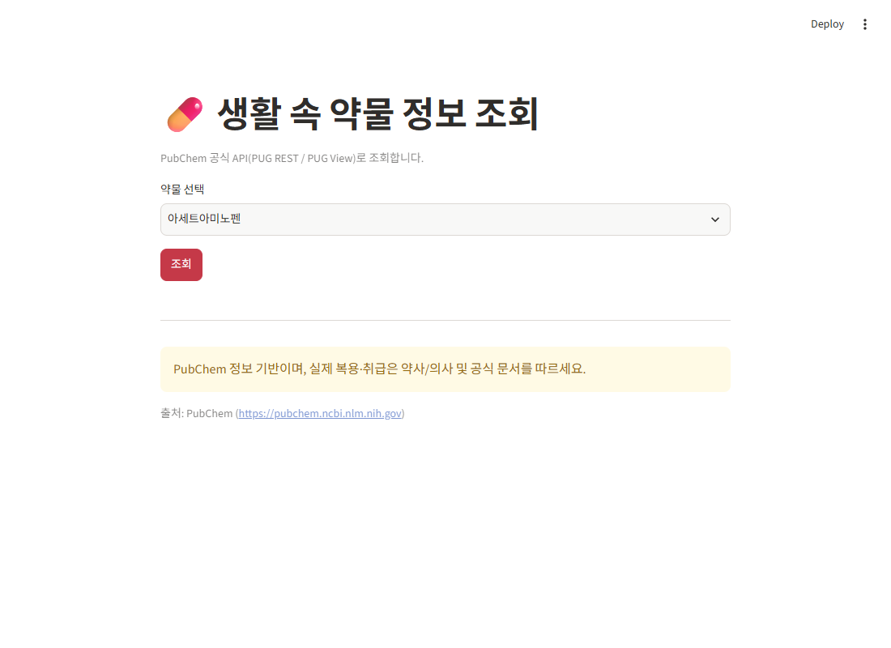
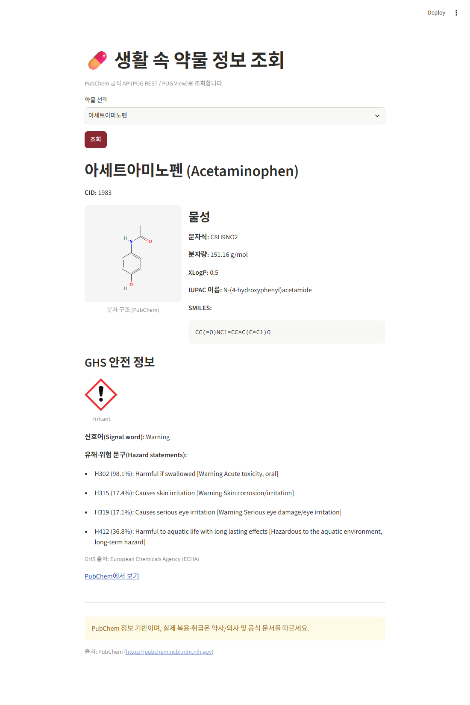

# 💊 생활 속 약물 정보 조회 앱

PubChem 공식 API로 생활 속에서 흔히 접하는 약물(아세트아미노펜, 이부프로펜, 아스피린, 카페인, 비타민 C)의 정보를 조회하는 Streamlit 웹 앱입니다.
웹 페이지 스크래핑 없이 공식 API만 사용하며, API 키는 필요 없습니다.

## 주요 기능

- 약물 이름(한글/영어)과 CID
- 물성: 분자식, 분자량, IUPAC 이름, SMILES, XLogP
- 분자 구조 이미지(PNG)
- GHS 안전 정보: Pictogram, Signal word, Hazard statements
- PubChem 출처 링크
- 같은 약물은 24시간 캐싱, 요청은 초당 최대 4회로 제한(PubChem 제한: 초당 5회)

## 사용한 PubChem API

기본 주소: `https://pubchem.ncbi.nlm.nih.gov/rest`

| 용도 | API | 엔드포인트 |
|---|---|---|
| 이름 → CID | PUG REST | `/pug/compound/name/{name}/cids/JSON` |
| 물성 | PUG REST | `/pug/compound/cid/{cid}/property/MolecularFormula,MolecularWeight,IUPACName,SMILES,XLogP/JSON` |
| 구조 이미지 | PUG REST | `/pug/compound/cid/{cid}/PNG` |
| GHS 안전 정보 | PUG View | `/pug_view/data/compound/{cid}/JSON?heading=GHS+Classification` |

PubChemPy는 사용하지 않고 `requests`로 직접 호출합니다.

## 설치 및 실행

Python 3.10 이상을 권장합니다(3.14에서 동작 확인).

```bash
# (선택) 가상환경
python -m venv venv
venv\Scripts\activate        # macOS/Linux: source venv/bin/activate

pip install -r requirements.txt
streamlit run app.py
```

브라우저에서 http://localhost:8501 이 열립니다.

## 파일 구조

```
├─ app.py             # Streamlit 화면, 캐싱
├─ pubchem_api.py     # PubChem API 호출, 레이트 리미터, GHS 파싱
└─ requirements.txt
```

## 스크린샷

<!-- 스크린샷을 docs/ 폴더에 넣고 아래 경로를 수정하세요 -->



## 한계점

- **한글 검색 불가**: PubChem 이름 검색은 한글을 인식하지 못해(404) 대표 약물 5종은 한글 표시명을 영어 이름에 매핑해 두었습니다. 그 외 약물은 영어 이름을 직접 입력해야 합니다.
- **출처마다 GHS 분류가 다름**: GHS 정보는 여러 기관(ECHA 등)이 각자 신고한 것이라 분류가 서로 다를 수 있습니다. 이 앱은 정보가 있는 첫 번째 출처의 묶음을 표시하고 출처명을 함께 보여 줍니다. 비타민 C처럼 "Not Classified"인 경우 신호어와 픽토그램이 없습니다.
- 이름 검색은 가장 첫 번째 CID를 사용하므로 염·이성질체 등이 있는 경우 원하는 화합물과 다를 수 있습니다.
- GHS는 화학물질로서의 취급 위험 분류이며, 복용 안전성(용법·용량·부작용)을 나타내지 않습니다.

## 안내

PubChem 정보 기반이며, 실제 복용·취급은 약사/의사 및 공식 문서를 따르세요.

데이터 출처: [PubChem](https://pubchem.ncbi.nlm.nih.gov)
